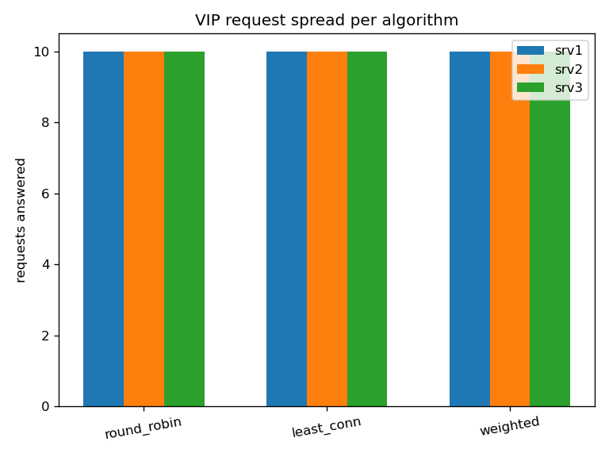
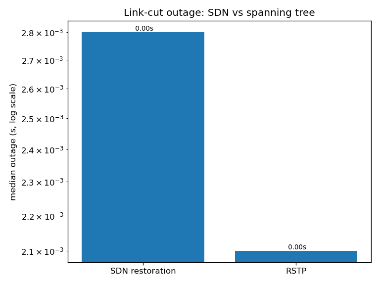

# Team 21 lab - evaluation results

Run started 2026-11-01 17:56:35. Emulated timings on one host: compare schemes against each other, not against hardware.

## E1 Functional

- Direct reachability: **30/30** host pairs.
- client -> VIP answered by backend: **srv1** (OK).

## E2 Load balancing (30 curls per algorithm)

| Algo | Spread (srv1/srv2/srv3) | Answered | Mean | p99 |
|---|---|---|---|---|
| round_robin | 10/10/10 | 30 | 6.36 ms | 8.71 ms |
| least_conn | 10/10/10 | 30 | 6.07 ms | 6.95 ms |
| weighted | 10/10/10 | 30 | 6.52 ms | 8.01 ms |

## E3 Failover (s1-s2 cut during 20 Hz VIP ping)

| Scheme | Median outage | Trials (ms) |
|---|---|---|
| SDN restoration | 2.8 ms | [2.8, 2.8, 19.2] | Controller reprogram: 1.3 ms.
| RSTP | 2.1 ms | [2.3, 2.1, 2.1] | Initial convergence: 5.1 s.

## E4 Security (UDP new-flow flood at the VIP)

| Policing | Legit curls OK | Legit failed | Flood Packet-Ins dropped |
|---|---|---|---|
| OFF | 0 | 4 | 0 |
| ON | 231 | 0 | 24975 |

